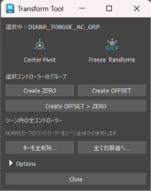

# Transform Tool




**Maya Utility Tool | Controller Setup & Transform Operations**

Autodesk Maya 2026向けに制作した、コントローラーのセットアップとトランスフォーム操作を効率化するPySide6ツールです。ZERO／OFFSETグループの作成、Transformの初期化、アニメーションキーの削除など、リギングとアニメーション制作で繰り返す操作を一つのコンパクトなUIにまとめました。

**「繰り返す操作は簡単に、既存の構造はできる限り維持する。」** ロック属性やConstraintによる入力接続を持つコントローラーにも対応し、ワールド位置や属性状態を考慮して処理する設計です。

## 目次

- [制作概要](#制作概要)
- [ツール全体・操作デモ](#ツール全体操作デモ)
- [主な機能](#主な機能)
- [技術的な設計と工夫](#技術的な設計と工夫)
- [起動方法・テスト](#起動方法テスト)
- [制作環境・リポジトリ構成](#制作環境リポジトリ構成)
- [公開について](#公開について)

## 制作概要

| 項目 | 内容 |
| --- | --- |
| 作品名 | Transform Tool |
| 担当 | ツール設計 / Python実装 / UI制作 |
| 使用ソフト | Autodesk Maya 2026 |
| 使用言語・UI | Python（`maya.cmds`） / PySide6 |
| 制作目的 | コントローラーのセットアップ・Transform操作の効率化 |
| 対象 | リギング / アニメーション制作 |

**設計方針**：①日常的な操作を一つのUIにまとめる ②既存の接続や属性状態を考慮する ③対象を確認しながら個別・一括操作を行えるようにする。

## ツール全体・操作デモ


| ZERO / OFFSET Creation | Scene Controller Operations |
| --- | --- |
|  |  |
| ワールド位置を維持したグループ作成 | コントローラーごとのTransform初期化 |

| Connection Preservation | Animation Key Cleanup |
| --- | --- |
|  |  |
| Constraintの入力接続を親グループへ移す | 対象を確認してアニメーションキーを削除 |

## 主な機能

### 01. 基本的なTransform操作


選択中のオブジェクトに対し、**Center Pivot**と**Freeze Transforms**を実行できます。

- **Center Pivot**：選択オブジェクトのピボットを中央へ移動
- **Freeze Transforms**：移動・回転・スケールをフリーズ（ジョイントは除外）

UI上部には選択中のオブジェクト名を表示します。複数選択時は件数と先頭2件を表示し、全名称はツールチップで確認できます。

### 02. ZERO / OFFSETグループの自動作成


選択したコントローラーに対し、ワールド位置を変えずにZERO／OFFSETグループを作成します。

| 操作 | 作成する階層 |
| --- | --- |
| Create ZERO | `ZERO > Controller` |
| Create OFFSET | `OFFSET > Controller` |
| Create OFFSET > ZERO | `OFFSET > ZERO > Controller` |

通常のコントローラーはグループ作成後、Translate／Rotateが`0`、Scaleが`1`になります。ZERO／OFFSETのサフィックスはOptionsから変更でき、Mayaのユーザー設定に保存されます。

### 03. Constraint・入力接続の維持


Parent Constraintなどによって移動・回転に入力接続がある場合、接続を新しい親グループへ移します。

- Constraint本体とターゲットは再作成しない
- コントローラー本体の移動・回転を`0`、スケールを`1`に戻す
- コントローラーのワールド位置を維持する
- `OFFSET > ZERO`では最外側のOFFSETグループへ入力接続を移す

単純なグループ追加で起こりやすい位置の変化や接続の組み直しを避けるため、既存の入力構造を考慮した処理を行います。

### 04. ロック・非表示属性への対応


Transform属性がロックされている場合は必要なロックを一時的に解除し、処理後に元の状態へ戻します。

- Transform属性のロック状態を復元
- Keyable状態を維持
- Channel Boxでの表示／非表示状態を維持
- 非表示かつロックされた属性にも対応

### 05. カーブ形状を持つジョイントコントローラー


Optionsの**「カーブ形状を持つジョイントも許可」**を有効にすると、NURBSカーブ形状を直接持つジョイントコントローラーもグループ作成の対象にできます。

`jointOrient`、`rotateAxis`、ワールド行列を維持し、通常のスケルトンジョイントは処理対象から除外します。

### 06. シーン内コントローラーのアニメーションキー削除


シーン全体からNURBSカーブ形状を持つコントローラーを検索し、全フレームのアニメーションキーを削除できます。非表示のコントローラーも対象です。

確認画面にはコントローラー名とキー数を表示し、処理前に対象を確認できます。

| 操作 | 内容 |
| --- | --- |
| 削除 | そのコントローラーのキーを削除 |
| × | 実行せず一覧から除外 |
| 一括削除 | 一覧に残ったコントローラーのキーを削除 |

### 07. コントローラーのTransform初期化


表示中のNURBSカーブコントローラーを検索し、安全に変更できるTransform属性を初期値へ戻します。

| 属性 | 初期値 |
| --- | --- |
| Translate XYZ | `0` |
| Rotate XYZ | `0` |
| Scale XYZ | `1` |

ロック、非表示、入力接続済みのチャンネルは変更しません。

各行の**移動／回転／スケール／すべて**から個別に実行でき、**×**で一覧から除外できます。個別処理または除外を行った項目は一覧から消え、対象件数にも反映されます。下部の一括ボタンは一覧に残ったコントローラーのみ処理します。

### 08. 対象を確認できるモードレスUI


一括操作の確認画面はモードレスで、開いたままMayaを操作できます。

- 8件以下では詳細を自動表示
- 9件以上では詳細を折りたたみ、展開後はスクロール可能
- コントローラーの表示名は親階層を省略
- 内部処理ではフルDAGパスを使用し、同名ノードを区別

## 技術的な設計と工夫


選択オブジェクトとシーン内コントローラーの操作を分け、単体操作・一括操作のどちらも対象が分かるUIにしています。グループ作成時は、ワールド位置・入力接続・属性状態を考慮した処理を行います。

| 制作上の課題 | 採用した設計 |
| --- | --- |
| ZERO作成でコントローラーの位置が変わる | ワールド位置を維持してグループを作成 |
| Constraint付きのコントローラーで接続の組み直しが必要 | 入力接続を新しい親グループへ移す |
| ロック属性があるとグループ作成に支障が出る | 一時解除とロック状態の復元 |
| カーブ付きジョイントをコントローラーとして使いたい | オプションで許可し、ジョイント固有の姿勢情報を維持 |
| 大量のコントローラーを一括操作したい | シーン検索と個別・一括処理 |
| 誤って対象外のコントローラーを処理してしまう | 確認画面で個別除外可能 |
| 同名ノードがあると対象を取り違える | フルDAGパスで識別 |
| 一括操作をまとめて戻したい | MayaのUndoに対応 |

### 既存の構造を守りながら、繰り返す操作を減らす

リギング作業では、同じ操作でもコントローラーの接続状態や属性設定が異なります。本ツールでは単純に処理をまとめるだけでなく、**ワールド位置・Constraint・ロック状態を考慮して操作できること**を重視しました。

各ボタン操作はMayaのUndoに対応し、一括処理も1回のUndoで戻せます。

## 起動方法・テスト

本ツールのフォルダーをMayaのPythonパスに追加し、Script EditorのPythonタブで起動します。

```python
import launch_transform_tool
```

開発中など、モジュールを再読み込みする場合：

```python
import importlib
import launch_transform_tool

importlib.reload(launch_transform_tool)
```

Maya 2026付属の`mayapy`からユニットテストを実行できます。

```powershell
& "C:\Program Files\Autodesk\Maya2026\bin\mayapy.exe" -m unittest discover -s tests -v
```

## 制作環境・リポジトリ構成

- Autodesk Maya 2026
- Python
- PySide6
- Windows
- unittest

以下は掲載素材の整理例です。ツール本体の既存のファイル構成は変更せず、画像・GIFだけ`docs/`へ追加する想定です。

```text
Transform-Tool/
├── README.md
├── launch_transform_tool.py
├── tests/
└── docs/
    ├── images/
    │   
    └── gifs/
        
```

## 公開について

- **Tool Design / Python / UI:** Yuzuki Midoshima
- **Target:** Autodesk Maya 2026
- **Purpose:** リギング・アニメーション制作の作業効率化

---

## Portfolio

[ViViViT](https://vivivit.com/yuzuki_midoshima)

## GitHub

[GitHub - Yuzuki Midoshima](https://github.com/Yuzuki-Midoshima)
